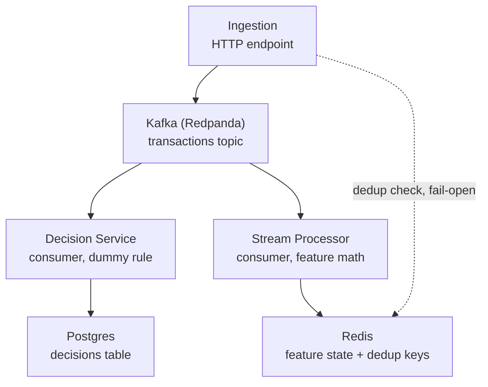

# Sentinel RFC

*As of 2026-10-26.*

## Overview

Sentinel is a real-time risk-decisioning platform: events stream in, get scored for fraud risk in milliseconds, and a decision service returns allow / flag / block with a full audit trail of how each decision was made.

It's built as a systems-design portfolio project — the point isn't "a model that predicts fraud," it's the infrastructure around it: high-throughput ingestion, stream processing, low-latency feature and model serving, and the operational tooling (Kubernetes, Terraform, observability) needed to run it reliably under load and failure. Most fraud/anomaly checks are either static rules (fast, rigid) or batch-scored models (accurate, slow); Sentinel scores every event in real time using computed behavioral features, while keeping deterministic rule overrides for cases that need guaranteed behavior.

## Goals and non-goals

**Goals**

- Sub-second, real-time event ingestion and decisioning
- Behavioral feature computation per user, not just a static amount threshold
- A full audit trail — every decision traceable back to its inputs
- Graceful degradation under dependency failure (Redis down, Kafka down, model-serving down)
- Demonstrate the full systems lifecycle end to end: local dev → containerized → Kubernetes → infrastructure as code → observability → load/chaos tested

**Non-goals**

- Production-grade fraud detection accuracy — the dummy threshold rule, and later a single gradient-boosted model, are illustrative, not state of the art
- A case-review UI or dashboard for human analysts
- Multi-currency or regulatory nuances of real payment systems

## Architecture

Events are published once, by ingestion, and read independently by two consumer groups off the same Kafka topic — decision-service and stream-processor — so a slow or failing consumer can never block the other.

## Current status

Phase 0 (foundations), Phase 1 (core pipeline: ingestion, decision service, idempotency), and Phase 2 (feature engineering and the data layer) are all complete and merged to `main`. Phase 2 shipped rolling feature math, the online Redis-backed feature store, an offline batch tool that replays the same math against Postgres history to produce a training dataset, and a formal writeup of where the online and offline paths diverge (`docs/feature-divergence.md`) — the most significant finding being that geo-distance can't be recomputed offline at all, since `decisions` never persisted location.

Phases 3 through 9 — model training and serving, wiring the model into the decision service, Kubernetes deployment, infrastructure as code, observability, load and chaos testing, and documentation polish — haven't started.

## Task-wise breakdown

### Phase 0 — Foundations ✅ Done

| Task | Status |
| --- | --- |
| Monorepo folders, `go.work` | Done |
| Docker Compose (Redpanda, Postgres, Redis) | Done |
| Health-check endpoint per service | Done |
| CI skeleton (GitHub Actions, per-module build/lint) | Done |

### Phase 1 — Core pipeline plumbing ✅ Done

| Task | Status |
| --- | --- |
| Task 1: ingestion HTTP endpoint + Kafka producer | Done |
| Task 2: decision service (Kafka consumer, dummy rule, Postgres) | Done |
| Task 3: idempotency (Redis fast path + Postgres backstop) | Done |

### Phase 2 — Feature engineering & data layer ✅ Done

| Task | Status |
| --- | --- |
| Task 1: rolling per-user feature computation | Done |
| Task 2: online feature store (Redis) | Done |
| Task 3: offline feature replay (training dataset) | Done |
| Task 4: document online/offline feature divergence | Done — see [`docs/feature-divergence.md`](feature-divergence.md) |

### Phase 3 — ML model training & serving ⬜ Not started

| Task | Status |
| --- | --- |
| Source/generate labeled dataset | Not started |
| Train gradient-boosted model (XGBoost/LightGBM) on Phase 2 features | Not started |
| Export to ONNX | Not started |
| Stand up model-serving endpoint (FastAPI) | Not started |

### Phase 4 — Wire model into decision service ⬜ Not started

| Task | Status |
| --- | --- |
| Decision service calls model-serving with the feature vector | Not started |
| Combine model score with hard rule overrides | Not started |
| Deliberate fail-open/fail-closed behavior on model-serving failure | Not started |
| Audit log: score, rules applied, verdict, per-stage latency | Not started |

### Phase 5 — Containerize & deploy to Kubernetes ⬜ Not started

| Task | Status |
| --- | --- |
| Dockerfiles per service, multi-stage builds | Not started |
| K8s manifests/Helm: deployment, service, resource limits, probes | Not started |
| HPA on Kafka consumer lag, not just CPU | Not started |
| Verify locally with kind/minikube first | Not started |

### Phase 6 — Infrastructure as code ⬜ Not started

| Task | Status |
| --- | --- |
| Terraform: managed K8s, Postgres, Redis, Kafka/MSK | Not started |
| Remote state backend | Not started |
| Full destroy/rebuild reproducibility | Not started |

### Phase 7 — Observability ⬜ Not started

| Task | Status |
| --- | --- |
| Prometheus metrics: latency, Kafka lag, inference latency, throughput, error rates | Not started |
| Grafana dashboards | Not started |
| Structured logs with correlation ID across an event's full path | Not started |
| Alerting rules | Not started |

### Phase 8 — Load testing & chaos ⬜ Not started

| Task | Status |
| --- | --- |
| Load generator, increasing throughput until bottleneck found | Not started |
| Chaos: kill a pod, kill a broker, inject latency into model-serving | Not started |
| Document recovery time and affected decisions | Not started |

### Phase 9 — Documentation & polish ⬜ Not started

| Task | Status |
| --- | --- |
| Design doc: problem statement, alternatives, trade-offs, capacity estimate | Not started |
| Architecture diagram | Not started |
| README with a working quickstart | Not started |
| Demo video/GIF | Not started |

## Key design decisions

| Decision | Choice made | Why |
| --- | --- | --- |
| Velocity feature windowing | Fixed 60s trailing window | A rule threshold ("block if >5 txns in 60s") needs an exact, interpretable count, not an approximated decayed rate |
| Amount deviation windowing | EWMA (α = 0.3) | Collapses unbounded history into O(1) state, rather than storing a user's full amount history or discarding anything past a window |
| Ingestion idempotency failure mode | Fail-open (publish anyway) if Redis is slow or down | Redis is only a fast-path optimization there; Postgres's `ON CONFLICT DO NOTHING` is the real backstop |
| Stream-processor feature-store failure mode | Fail-closed (don't commit the Kafka offset) if a Redis write fails | Redis is the *only* copy of feature state on this path — no backstop, so a lost write must stall and retry, not disappear silently |
| Offline training dataset output format | CSV file | Natural handoff into the planned Python/XGBoost training code in Phase 3, with no database dependency needed there |
| Offline replay code location | A second `cmd/` binary inside the `stream-processor` module | It needs to import `internal/features` directly; Go's `internal/` visibility rule blocks any other module from reaching it |

## Known gaps and open questions

- [x] ~~Geo-distance can't be recomputed offline~~ — documented in `docs/feature-divergence.md`: the `decisions` table has no `location` column, so the offline replay tool always treats it as absent. The gap itself is still open (nothing persists location yet); Phase 3 should exclude this feature from training rather than impute it as zero.
- [x] ~~Velocity and time-since-last timestamp basis~~ — documented in `docs/feature-divergence.md`: both are computed offline from `created_at` (decision time), not the original event timestamp, which isn't persisted. Usually close, degrades under the same failure modes Phase 1 Task 3 already tested (Kafka/Redis outages, redelivery).
- [ ] Training labels are weak — the only label-like column is `decision`, produced by the current dummy amount-threshold rule, not real fraud ground truth. Phase 3 will need to source or simulate real labels.
- [ ] Branch protection on `main` was discussed but never completed (blocked on GitHub CLI authentication) — anyone with push access can currently push directly to `main`.
- [ ] No unit tests yet for `stream-processor`'s Redis-backed `store` or `consumer` packages — only verified via live runs so far. Only the storage-agnostic `features` and `replay` packages have unit coverage.

## Next steps

Phase 2 is complete. The project now moves into Phase 3: sourcing/generating a labeled dataset and training the actual model — informed directly by `docs/feature-divergence.md`'s recommendation to exclude geo-distance from the training feature set rather than impute it.

A detailed breakdown of the next five tasks across Phases 3 follows separately.
